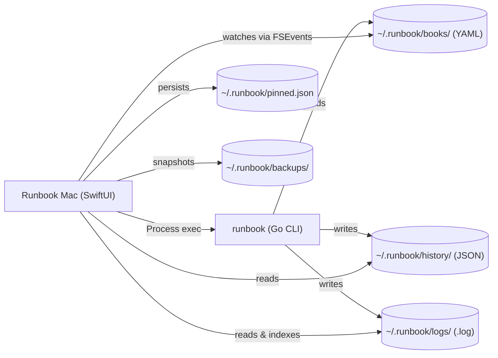
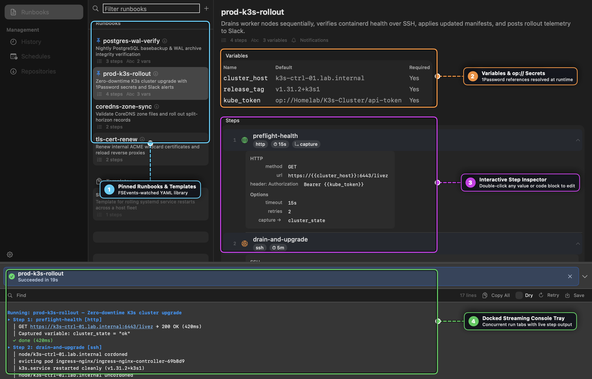
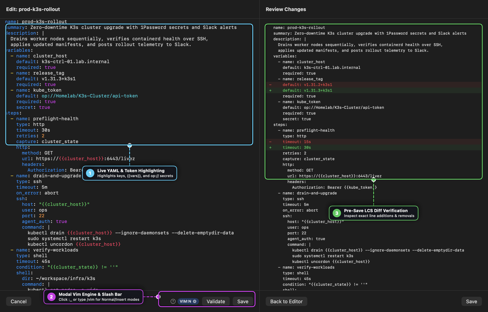
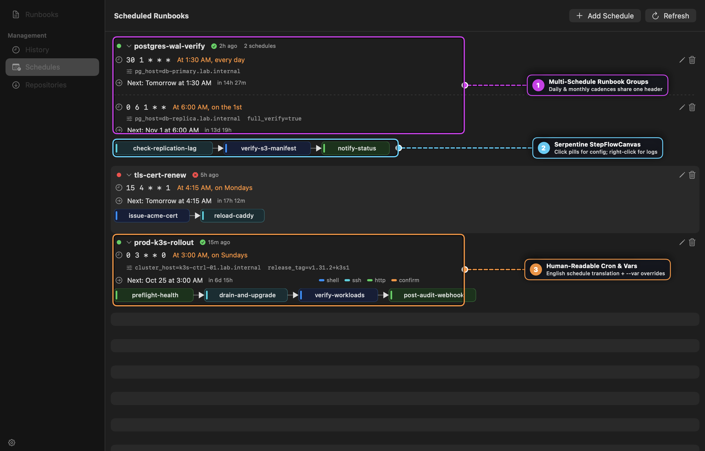
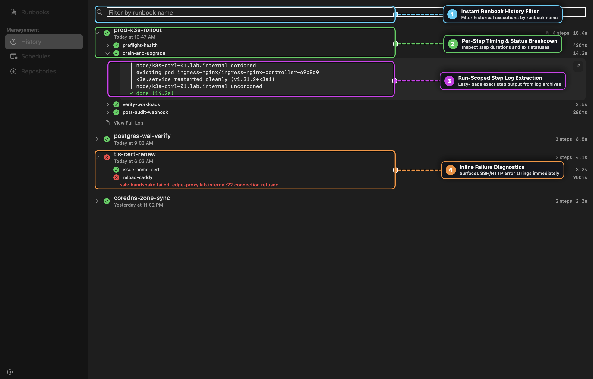

# Runbook User Guide

**Runbook** is a native macOS workbench for discovering, authoring, executing, and scheduling declarative YAML runbooks powered by the [`runbook` CLI](https://github.com/msjurset/runbook). It pairs a three-panel SwiftUI interface with a non-modal streaming console tray, a Vim-enabled YAML and inline code editor, a visual serpentine step pipeline (`StepFlowCanvas`), and run-scoped historical log extraction.

---

## Table of Contents

1. [Installation & First-Launch CLI Setup](#1-installation--first-launch-cli-setup)
2. [Architecture: Frontend to the `runbook` Engine](#2-architecture-frontend-to-the-runbook-engine)
3. [The Runbook Workbench & Docked Console Tray](#3-the-runbook-workbench--docked-console-tray)
4. [YAML Authoring, Modal Vim Engine & Pre-Save Diff Review](#4-yaml-authoring-modal-vim-engine--pre-save-diff-review)
5. [Schedules & Visual Step Flow Pipelines](#5-schedules--visual-step-flow-pipelines)
6. [Execution History & Run-Scoped Step Log Slices](#6-execution-history--run-scoped-step-log-slices)
7. [Shared Collections & Templates (`runbook pull`)](#7-shared-collections--templates-runbook-pull)
8. [State on Disk & File Locations](#8-state-on-disk--file-locations)
9. [Keyboard Shortcuts & Reference](#9-keyboard-shortcuts--reference)
10. [Troubleshooting & Decision Trees](#10-troubleshooting--decision-trees)

---

## 1. Installation & First-Launch CLI Setup

### Homebrew (Recommended)

```sh
brew install --cask msjurset/tap/runbook-mac
```

Installing the cask places `Runbook.app` into `/Applications/` and automatically installs the companion `runbook` CLI binary if it is not already present.

### Building from Source

```sh
make deploy
```

Builds the universal macOS binary, packages the `.app` bundle, and installs it into `/Applications/Runbook.app`.

### First-Launch CLI Auto-Install & Updates

On launch, Runbook verifies that the `runbook` CLI binary is available in your `PATH` (or `~/.local/bin`, `/opt/homebrew/bin`, `/usr/local/bin`). If missing, the **CLI Setup Sheet** opens automatically:

1. **Step 1 — Install CLI**: Downloads the latest release tarball from GitHub, installs the binary into `~/.local/bin`, and installs the man page and Zsh completion scripts.
2. **Step 2 — Pull Shared Runbooks (Optional)**: Clones a starter collection into `~/.runbook/books/` so you can explore working examples immediately.

Once installed, Runbook checks for new CLI releases once every 24 hours and surfaces a non-intrusive **CLI Update Banner** at the top of the window whenever an upgrade is available.

---

## 2. Architecture: Frontend to the `runbook` Engine

Runbook Mac intentionally contains **zero** divergent execution logic. Every execution, validation pass, schedule change, and git repository pull delegates directly to the `runbook` CLI binary on disk:



- **Single Source of Truth**: Running a playbook from the macOS app produces the exact same behavior, history JSON, and log markers as running `runbook run` from an SSH session or cron job.
- **Live Filesystem Sync (`FSEvents`)**: `RunbookStore` watches `~/.runbook/books/` via macOS `FSEvents`. Editing a YAML file in Neovim or pulling a git repo in your terminal updates the GUI sidebar automatically without manual refreshes.

---

## 3. The Runbook Workbench & Docked Console Tray



### Visual Callout Guide

1. **Pinned Runbooks & Templates (`RunbookListView`)**: Browse all discovered runbooks in `~/.runbook/books/` and 1-level subdirectories. Frequently used playbooks can be pinned to the top (`~/.runbook/pinned.json`), while reusable scaffolds under `templates/` appear in a dedicated collapsible **Templates** section.
2. **Variables & `op://` Secrets**: Declared inputs are displayed with their default values and required flags. Secret references using 1Password (`op://Vault/Item/Field`) are never stored in plaintext—they resolve at runtime through the CLI and system Keychain cache.
3. **Interactive Step Inspector**: Click any step row to inspect its `shell`, `ssh`, `http`, or `confirm` parameters, timeouts, retry policies, `capture` targets, and `condition` expressions. Double-click any single-line value to edit it inline, or double-click a multiline command/payload block to open the syntax-highlighted popout editor.
4. **Docked Streaming Console Tray (`ConsoleTray`)**: Launching a runbook opens the non-modal bottom tray. Multiple runbooks can execute concurrently—each session gets its own tab in `SessionTabBar` with live status icons, elapsed timers, regex-driven output coloring (`~/.runbook/highlights.yaml`), clickable URLs, inline search (`⌘F`), cancellation (`⌘.`), and 1-click **Retry** with an inline **Dry** toggle.

---

## 4. YAML Authoring, Modal Vim Engine & Pre-Save Diff Review



### Visual Callout Guide

1. **Live YAML & Token Highlighting (`CodeEditorView`)**: Full-file YAML editor with live syntax coloring for YAML keys, strings, booleans, numbers, comments, `{{variable}}` template tokens, and `op://` 1Password secret references. Press `Tab` for context-aware schema completion (`steps:`, `type:`, `on_error:`, etc.).
2. **Modal Vim Engine & Slash Command Bar (`VimToolbarItem`)**: Every multiline editor starts in standard macOS editing mode (`VIM=OFF`). Click the `:_` watermark button or type `/vim` at the start of a line to activate modal Vim editing (`VIM:N`, `VIM:I`, `VIM:V`) powered by `VimEngine`, complete with an interactive `?` command cheatsheet popover and `:w` / `:wq` / `:q` ex-commands.
3. **Pre-Save LCS Diff Verification (`DiffView`)**: Clicking **Save** (or `:w`) computes a line-by-line Longest Common Subsequence (LCS) diff comparing the on-disk YAML against your buffer. Every save automatically writes a timestamped snapshot to `~/.runbook/backups/` before modifying the file.

---

## 5. Schedules & Visual Step Flow Pipelines



### Visual Callout Guide

1. **Multi-Schedule Runbook Groups (`CronRunbookGroupView`)**: When a runbook is scheduled across multiple cadences (for example, a daily incremental run and a monthly full verification), Runbook groups them under a single runbook card with individual schedule sub-rows and a shared step pipeline.
2. **Serpentine StepFlowCanvas (`StepFlowCanvas`)**: Custom SwiftUI `Canvas` pipeline that draws each step as a color-coded pill (`shell` = blue, `ssh` = orange, `http` = green, `confirm` = gray):
   - **Left-click a pill**: Opens a popover displaying the step's full configuration and syntax-highlighted code block.
   - **Right-click a pill**: Opens a popover with the **most recent run's log slice** for that specific step.
   - **Double-click a pill**: Navigates directly to the Runbook Detail view and expands that step.
3. **Human-Readable Cron & `--var` Overrides (`CronScheduleRow`)**: Translates 5-field cron expressions into plain English (e.g., `"At 3:00 AM, on Sundays"`), calculates a live relative countdown to the next execution, and displays per-schedule `--var key=value` overrides inline.

---

## 6. Execution History & Run-Scoped Step Log Slices



### Visual Callout Guide

1. **Instant Runbook History Filter**: Filter historical runs across `~/.runbook/history/*.json` by runbook name in real time.
2. **Per-Step Timing & Status Breakdown**: Expand any execution row to inspect individual step statuses (`✓` success, `✗` failed, `⊘` skipped) and millisecond/second durations.
3. **Run-Scoped Step Log Extraction (`StepLogExtractor`)**: Expanding a step inside a historical run lazy-loads the exact stdout/stderr slice for **that specific run and step** (correlating `LogIndex` and timestamp markers with a 60-second mtime safety gate so append-mode logs never leak output from older runs).
4. **Inline Failure Diagnostics**: Failed steps immediately surface their captured error string (such as SSH handshake failures or non-zero exit codes) directly beneath the step row.

---

## 7. Shared Collections & Templates (`runbook pull`)

The **Repositories** sidebar section (`⌘4`) provides a visual manager for git-backed runbook collections:

- **Pull New Repository**: Clone any Git repository or download a standalone `.yaml` URL into `~/.runbook/books/<repo>/`.
- **Update & Remove**: Fast-forward existing checkouts (`git pull --ff-only`) or remove unused collections.
- **Template Discovery**: Any YAML files inside a `templates/` directory (local or inside a pulled repository) are automatically separated into the **Templates** section so teams can scaffold standardized playbooks via **New from Template**.

> [!TIP]
> **Customizing a Pulled Runbook**: Avoid editing files directly inside `~/.runbook/books/<repo>/`, as local modifications will block `git pull --ff-only`. Instead, right-click the runbook and choose **Duplicate** (or copy it to the top-level `~/.runbook/books/` directory). Top-level runbooks automatically take precedence over subdirectory runbooks with the same name.

---

## 8. State on Disk & File Locations

| Path | Format | Managed By | Purpose |
|------|--------|------------|---------|
| `~/.runbook/books/*.yaml` | YAML | App & CLI | Top-level user runbooks |
| `~/.runbook/books/<repo>/` | Git checkout | CLI (`runbook pull`) | Shared runbook collections |
| `~/.runbook/books/**/templates/` | YAML | User / Repo | Reusable runbook templates |
| `~/.runbook/history/*.json` | JSON | CLI | Per-execution metadata and step timings |
| `~/.runbook/history/<name>.log` | Plain text | CLI (cron) | Append-only stdout/stderr for scheduled runs |
| `~/.runbook/logs/*.log` | Plain text | App & CLI | Per-run output logs captured by the GUI and CLI |
| `~/.runbook/logs/index.json` | JSON | App & CLI | Maps `(runbookName, startedAt)` to exact log file paths |
| `~/.runbook/pinned.json` | JSON array | App | Pinned runbook names |
| `~/.runbook/backups/` | YAML snapshots | App | Automatic pre-save and pre-delete YAML backups |
| `~/.runbook/highlights.yaml` | YAML rules | User | Custom regex colorization rules for console & log output |

---

## 9. Keyboard Shortcuts & Reference

### Global Navigation

| Shortcut | Action |
|----------|--------|
| `⌘K` | Open Quick Jump palette |
| `⌘1` | Switch to **Runbooks** |
| `⌘2` | Switch to **History** |
| `⌘3` | Switch to **Schedules** |
| `⌘4` | Switch to **Repositories** |
| `⌘N` | Create New Runbook |
| `⌘R` | Reload runbooks and history from disk |
| `⌘,` | Open Settings |
| `⌘?` | Open Runbook Help window |

### Console Tray & Editor

| Shortcut | Context | Action |
|----------|---------|--------|
| `⌘F` | Console Tray | Toggle inline output search bar |
| `⌘.` | Console Tray | Stop the currently focused running session |
| `Return` / `⇧Return` | Console Search | Jump to next / previous search match |
| `Tab` | YAML Editor | Insert context-aware YAML key/value completion |
| `/vim` | Any Multiline Editor | Toggle modal Vim editing (`VIM:N` / `VIM:I` / `VIM:V`) |
| `:w` / `:wq` / `:q` | Vim Normal Mode | Save (with diff review), save & close, or exit Vim mode |
| `⌘W` | Code Popout Editor | Close popout editor and commit changes to YAML |

---

## 10. Troubleshooting & Decision Trees

### Run Finishes, But History View Doesn't Show It

- **Was it a Dry Run?** Dry runs (`--dry-run`) intentionally skip writing JSON history records and on-disk log files so exploratory previews never pollute your success/failure metrics in History or Schedules. Use the **Save** button in the console tray toolbar if you want to archive a dry-run transcript.
- **Refresh the View**: Press `⌘R` or switch sidebar tabs to reload `~/.runbook/history/*.json`.

### Step Log Slice Shows "Loading…" or Wrong Content

1. Verify whether logs were rotated externally (`newsyslog` / `logrotate`).
2. Run `runbook log reindex` in your terminal to rebuild `~/.runbook/logs/index.json` across `~/.runbook/logs/` and `~/.runbook/logs/archive/`.

### Scheduled Runbooks Install But Never Fire on macOS

1. Open **System Settings → Privacy & Security → Full Disk Access** and ensure `/usr/sbin/cron` is enabled.
2. Ensure every variable required by the scheduled runbook either has a `default:` in YAML, is passed via schedule `--var key=value` overrides, or uses a pre-warmed `op://` secret (`runbook auth <name>`).

### Deep-Dive Guides

For additional architectural notes and narrative walkthroughs, see the companion guides in [`docs/guide/`](guide/index.md):
- [Getting Started](guide/01-getting-started.md)
- [Core Concepts](guide/02-concepts.md)
- [UI Cookbook](guide/03-cookbook.md)
- [Complete Reference](guide/04-reference.md)
- [Troubleshooting Guide](guide/05-troubleshooting.md)
- [Running as a Service](guide/06-running-as-a-service.md)
- [Thinking in Runbook Mac](guide/07-thinking-in-runbook-mac.md)
